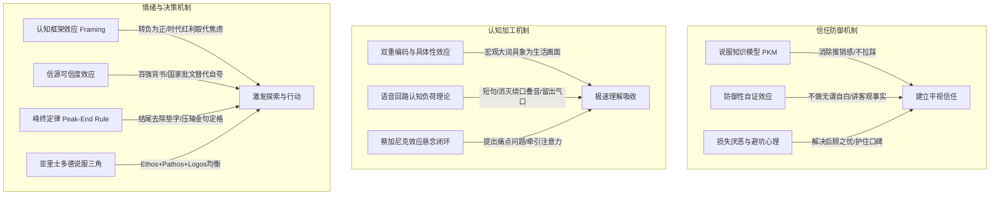

# Human Article Skill: 商业与视频文案“去公文AI腔”人话重塑引擎

> **将冰冷的公文AI腔、汇报PPT与假大空材料，重塑为自然、有力、合规且直击人心的口播视频脚本与人话文案。**

[](https://opensource.org/licenses/MIT)
[](SKILL.md)

---

## 🌟 核心理念 (Core Principle)

> **写给耳朵听，不是写给眼睛看；用生活经验对话，不拿宏观公文说教。**

改文案的表象是“修字删词”，**底层本质是认知科学、传播心理学与行为经济学的精密博弈**。一段文案如果让人觉得“不像人话、假大空、油腻、反感”，根本原因在于它违背了人脑接收信息和建立信任的心理学规律。

---

## 🏛 跨学科四大第一性原理 (The 4 First Principles)

1. **博弈论：扎哈维“昂贵信号理论” (Costly Signaling)**：杜绝口号式的廉价信号 (Cheap Talk)，只用高成本质押、不可伪造的“昂贵信号”建立信任（22年制药光阴、6大实体基地、128家公立三甲临床双盲、特医食品批文）。
2. **物理学：香农信息论与高信噪比 (Shannon's SNR)**：文案的本质是消除不确定性；消灭零信息量的“高熵公文噪声”，输出极高信噪比的事实。
3. **神经生物学：三元神经递质化学开关 (Neurochemical Triad)**：3分钟内精准依次击发：**皮质醇**（痛点警醒）$\rightarrow$ **催产素**（同盟归属）$\rightarrow$ **多巴胺**（行动奖赏）。
4. **演化心理学：敦巴“社会脑与声波梳毛假说” (Social Brain)**：语言的原初意义是同盟梳毛；用平视温度的“声波梳毛”替代冷冰冰的公文教条。

---

## 🧠 10 大认知与传播心理学底层支柱

本技能体系依托 10 大经过实证的传播学与认知心理学定律构建：



1. **防御性自证与过度辩解效应**：越刻意强调“初心很纯粹、绝不割韭菜”，越像“不打自招”；永远只陈述客观事实与业务动作。
2. **说服知识模型 (PKM)**：现代人对推销极度防备；坚决不拉踩竞品、不浮夸自吹，讲用户对高标准的追求。
3. **认知框架效应 (Framing Effect)**：转负为正，以时代红利驱动，不靠制造恐慌与贩卖焦虑谋利。
4. **具体性效应与双重编码理论**：把抽象宏观大词翻译成电影分镜画面（如“十万公里血管河道”）。
5. **信源可靠度效应**：拒绝小作坊自嗨的“自研自产”，用百强药企、三甲医院、HACCP资质等硬核第三方信源背书。
6. **语音回路与认知负荷理论**：写给耳朵听，控制单句长度在 1~2 口气内，消灭同音撞车与动宾语病。
7. **峰终定律 (Peak-End Rule)**：结尾拒绝冗长公文垫字，用独立高潮金句干净定格。
8. **亚里士多德说服三角**：权威品格 (Ethos) + 理性逻辑 (Logos) + 情感共鸣 (Pathos) 黄金三角平衡。
9. **损失厌恶与反向安全感**：创业者最怕透支人情和砸口碑；先破后顾之忧，再谈未来收益。
10. **蔡加尼克效应与认知悬念**：前置核心痛点问题，牵引注意力进入后续解法。

---

## 🔍 四阶盲审复核引擎 (The 4-Pass Verification Engine)

文案交付前必须依次通过 4 道不可逾越的质检防线：

1. **第一阶：耳朵盲听审查 (The Blind Listening Pass)**：闭上双眼纯靠耳朵听，排查一切听觉卡顿、绕口叠音与气口不足。
2. **第二阶：杠精防御者审查 (The Cynical Auditor Pass)**：化身极度挑剔怀疑的客户，排查自证清白、自我感动、自嗨吹牛。
3. **第三阶：法务与合规红线扫描 (The Compliance Red-Line Scan)**：广告法排查，绝对承诺词清零，精准定义合作名分（未盖章协议严禁虚标“战略合作”，规范使用“携手”）。
4. **第四阶：视听节拍与音画对应测试 (The Metronome & B-Roll Match)**：3.4~3.6字/秒打节拍，确保每句话都有具体的摄像机镜头可以承载。

---

## 📁 项目目录导航

```
human-article/
├── SKILL.md                      # 核心技能标准规范（Agent 适用）
├── README.md                     # 项目全景概览与介绍
└── references/
    ├── audit-protocol.md         # 四阶盲审复核 SOP 手册与 100 分打分卡
    ├── lexicon.md                # 公文AI腔 → 心理学人话 核心即查对照词典
    ├── checklist.md              # 20 项防坑快速自查打钩清单
    └── case-study.md             # “大家庭” 企业宣传片 6 轮实战蜕变剖析全记录
```

---

## 🚀 如何使用该技能

### 1. 作为 AI Agent 技能集成
将本目录软链接或复制到你的 Agent 技能目录（如 `~/.gemini/antigravity/skills/` 或 `~/.claude/skills/`）：
```bash
ln -s /path/to/human-article ~/.gemini/antigravity/skills/human-article
```

### 2. 人工文案创作与审核参考
* 创作时：查阅 [`references/lexicon.md`](references/lexicon.md) 快速替换公文腔；
* 审核时：对照 [`references/checklist.md`](references/checklist.md) 逐项打钩；
* 定稿前：执行 [`references/audit-protocol.md`](references/audit-protocol.md) 进行四阶盲审打分。

---

## 📄 License

MIT License
