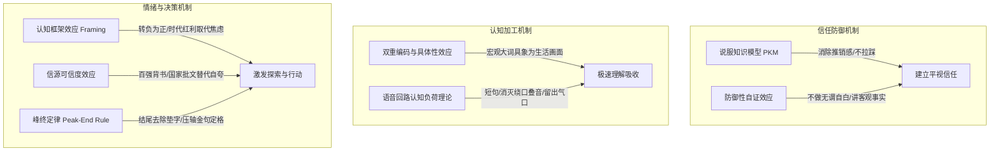
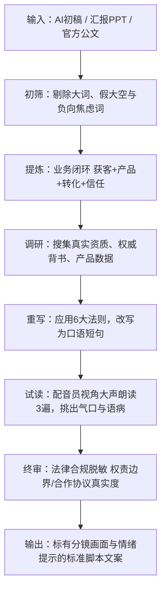

# Human Article: 将公文AI腔重塑为自然“人话”文案

## 核心理念 (Core Principle)

> **写给耳朵听，不是写给眼睛看；用生活经验对话，不拿宏观公文说教。**

改文案的表象是“修字、删词”，**底层本质是认知科学与传播心理学的精密博弈**。一段文案如果让人觉得“不像人话、假大空、油腻、反感”，根本原因在于它违背了人脑接收信息和建立信任的心理学规律。

---

## 传播心理学底层理论体系 (Psychological Foundations)

优秀的人话文案，背后依托着 7 大经过实证的传播学与认知心理学定律：

### 1. 防御性自证与过度辩解效应 (Defensive Self-Proof & Overjustification Effect)
* **心理机制**：归因理论（Attribution Theory）指出，当说话者无缘无故主动强调自身动机的高尚（如*“我们的初心很纯粹”、“我们绝不割韭菜”、“我们是真心的”*），受众会本能地启动逆向归因怀疑：*“他为什么要刻意强调这点？他想掩盖什么？是不是此地无银三百两？”*
* **文案底层逻辑**：**永远不要主动标榜道德，只陈述客观事实与业务动作。** 真正有实力的平台从来不解释初心多么高尚，而是直接展现“我们搭建了什么、解决了什么、带来了什么”。

### 2. 说服知识模型 (Persuasion Knowledge Model, PKM)
* **心理机制**：现代受众拥有高度成熟的“反营销免疫系统”。一旦识别出拉踩竞品（如*“市面上很多贴牌代工虚假宣传”*）或浮夸自吹（如*“极致产品力”*），受众的心理抗拒机制（Psychological Reactance）会瞬间被激活，直接将你归类为“心虚狡黠的推销者”。
* **文案底层逻辑**：**行王道，不走霸道；讲用户的期待，不踩同行的烂。** 坦荡讲“关乎健康，大家对配方严谨与透明度有了更高要求”，既树立了行业新标杆，又杜绝了商战小家子气。

### 3. 认知框架效应 (Framing Effect)
* **心理机制**：卡尼曼前景理论表明，信息的呈现框架直接决定了决策情绪。消极框架（*“生意越来越卷、流量贵、慢性病危机”*）会激活大脑杏仁核的恐惧与回避中枢，容易让人感到压抑并选择关掉视频；积极框架（*“确定性方向、时代红利清晰浮现、长寿时代”*）能激活前额叶皮层的探索欲与希望感。
* **文案底层逻辑**：**转负为正，以时代红利驱动，不靠制造恐慌牟利。**

### 4. 具体性效应与双重编码理论 (Concreteness Effect & Dual-Coding Theory)
* **心理机制**：佩维奥（Paivio）研究表明，人脑对“具体表象名词”的提取和加工速度比“抽象概念”快数倍。宏观大词（如*“人口结构持续变迁”、“全域生态”、“技术红利”*）在大脑中无法形成画面，只能导致认知走神。
* **文案底层逻辑**：**把抽象指标翻译成电影分镜。** 将心血管疾病具象化为“十万公里的血管河道、熬夜高油盐带来的淤堵、堵了70%才被发现”，大脑瞬间形成震撼的生理画面。

### 5. 信源可靠度效应 (Source Credibility Theory)
* **心理机制**：霍夫兰德（Hovland）研究表明，受众在做价值判断时，采用最节省能量的“信源权威启发式”。企业单方面的“自研自产”属于极低信任度的自嗨；而“国家级特医批文”、“中国医药百强柯菲平”、“128家三甲医院合作”属于不可伪造的高可靠度信源。
* **文案底层逻辑**：**借船出海，用客观硬核资质锚定信任底盘。**

### 6. 语音回路与认知负荷理论 (Cognitive Load & Phonological Loop)
* **心理机制**：耳朵的工作记忆容量极其短暂脆弱。当听到长复合句、近距离同音打架（*“让一个人的一人公司”*）、生硬动宾语病（*“通畅健康”*）时，语音回路会瞬间发生解码拥堵，听众会产生生理性的微小烦躁。
* **文案底层逻辑**：**口语化短句，控制单句长度在 1~2 口气内，消除一切近音相撞与动宾拗口。**

### 7. 峰终定律 (Peak-End Rule)
* **心理机制**：用户对一段视听内容的终极感知，由“最强高潮点（Peak）”和“收尾结局（End）”决定。如果在结尾加上*“我们的使命始终如一：……”*等公文垫字，就像交响乐在高潮后突然开始念旁白台词，前功尽弃。
* **文案底层逻辑**：**结尾拒绝冗长，用独立高潮金句干净定格。**

### 8. 亚里士多德修辞三要素 (The Rhetorical Triangle: Ethos, Pathos, Logos)
* **心理机制**：伟大的商业说服，必须在三者之间形成精密三角力场：
  * **品格背书 (Ethos)**：解决“我凭什么信你” $\rightarrow$ 百强药企底蕴、三甲医院临床、特医资质；
  * **理性逻辑 (Logos)**：解决“这事合不合逻辑” $\rightarrow$ 3.3亿血管刚需、全域获客到微信沉淀闭环；
  * **情感共鸣 (Pathos)**：解决“这事跟我有什么关系” $\rightarrow$ 长寿时代的家人守护、让平凡人被看见。
* **文案底层逻辑**：**警惕“纯 Logos 陷阱”。** AI 初稿最容易写成满篇枯燥干瘪的劣质逻辑，必须注入硬核 Ethos 与温情 Pathos。

### 9. 损失厌恶与反向安全感 (Loss Aversion in Prospect Theory)
* **心理机制**：行为经济学表明，人对损失的敏感度是收益的 2~2.5 倍。创业者最害怕的不是“少赚一点”，而是“名誉扫地、透支熟人亲友人脉”。
* **文案底层逻辑**：**优先解决后顾之忧，再谈未来收益。** 强调“跳出熟人圈、全域获客、制药级标准自己吃得踏实”，精准化解听众内心最恐惧的潜在损失。

### 10. 蔡加尼克效应与认知悬念 (Zeigarnik Effect & Open Loops)
* **心理机制**：大脑对未解答的问题会保持极高的张力与注意力。
* **文案底层逻辑**：**先抛痛点之问，再给笃定之解。** 例如在引出解决方案前，先点出“想做好轻创业，核心考验两件事：源源不断的客流，和过硬的供应链”，让大脑自动带着好奇心进入后续章节。

---

## 诊断清单：AI与公文腔的 7 大典型病灶

在重构文案前，先扫描以下 6 类高频“假大空”与“拗口”问题：

| 病灶类型 | 典型特征 / 关键词 | 为什么必须改 |
|---|---|---|
| **1. 宏观大词堆砌** | “人口结构变迁”、“技术红利涌现”、“构建全域生态” | 抽象冰冷，听众第一秒就走神，像在听统计局做报告。 |
| **2. 负向拉踩与贩卖焦虑** | “生意越来越卷”、“市面上很多贴牌代工虚假宣传”、“路越走越窄” | 攻击同行显格局狭隘，加剧听众抵触与焦虑情绪。 |
| **3. 隐性承诺与法律风险词** | “全程兜底”、“货源你不用操心”、“稳赚不赔” | 在商业法律与广告合规上属于违规绝对承诺，招致法律纠纷。 |
| **4. 商业合作关系虚高** | 未签署正式法务协议，随口使用“深度战略合作”、“背靠” | “背靠”显依附低位；“战略合作”无协议则涉嫌虚假宣传。 |
| **5. 抽象论文腔与同音绕口** | “研发的科学性与品质的透明度”、“让一个人的一人公司” | 口播发音舌头打架，听众大脑解码成本极高。 |
| **6. 机械公文垫字** | “我们的使命始终如一：……”、“我们始终坚守……” | 像在照读 PPT 目录，打破了视频解说自然流淌的叙事氛围。 |
| **7. 防御性自证与自我感动** | “我们的初心很纯粹”、“我们绝不割韭菜”、“我们是真心的” | 越刻意强调“纯粹”，听众潜意识越觉得“此地无银三百两”，缺乏大企业的从容与自信。 |

---

## 重构文案的 6 大法则 (Methodology)

### 法则一：转负为正（正向叙事法则）
* **原则**：永远不抱怨环境、不拉踩竞品，把“焦虑”升级为“时代趋势与生活期待”。
* **实战改法**：
  * *初稿*：“生意越来越卷，传统电商流量越来越贵。”
  * *重构*：“当商业模式迎来重塑，有两个巨大的时代红利，正清晰地摆在眼前。”
  * *初稿*：“市面上很多营养品深陷贴牌代工与虚假宣传。”
  * *重构*：“关乎生命健康，大家对配方够不够科学、品质透不透明，比以往任何时候都更加在意。”

### 法则二：合规脱敏与权责边界（企业安全法则）
* **原则**：把“结果承诺”改为“能力赋能与过程陪伴”；严格依据法律事实界定合作身份。
* **实战改法**：
  * *初稿*：“聚星商学苑全程兜底 / 货源你不用操心。”
  * *重构*：“聚星商学苑全程系统赋能 / 在货源上，平台就是坚实的后盾。”
  * *初稿*：“与某某集团达成深度战略合作（实未签战略协议）/ 背靠某某品牌。”
  * *重构*：“深度携手某某集团，共享某某百强药企 22 年的科研底蕴。”

### 法则三：大词消解与具象化（人话听觉法则）
* **原则**：把行业宏观词汇换成老百姓生活中摸得着、看得见的具象意象。
* **实战改法**：
  * *初稿*：“人均预期寿命稳步延长，人口结构持续变迁 / 大家越来越惜命。”
  * *重构*：“长寿时代的到来，活得健康、活得有品质，成了千家万户最坚定的追求。”
  * *初稿*：“心脑血管疾病高发，危害严重。”
  * *重构*：“我国心脑血管疾病人群已突破 3.3 亿。人体十万公里的血管河道，在日复一日的高油高盐与熬夜压力下，默默承受淤堵与老化。”

### 法则四：外部权威锚定（拒绝作坊式自嗨）
* **原则**：“自研自产”四个字容易被误认为小作坊王婆卖瓜，必须用硬核第三方资质和国家级认证来做信用锚点。
* **实战改法**：
  * *初稿*：“我们全线产品自研自产，配方有依据，原料有来处。”
  * *重构*：“依托特医级研发实力，参照药品级标准打造‘药膳级’洁净车间，不仅拿下 HACCP、ISO22000 等多项国际权威认证，更手握国家严苛审批的特医食品批文，做到全程可追溯。”

### 法则五：气口呼吸与动宾修剪（口播声律法则）
* **原则**：视频旁白必须能“一口气念顺”，坚决消灭读音打架、句式重音冲突和动宾搭配不当。
* **实战排查点**：
  * **消灭绕口叠音**：“让每一个普通人的‘一人公司’” $\rightarrow$ **“让每一位个人创业者”**。
  * **消除近距离词汇撞车**：上一句写“深扎 22 年”，下一句紧接着“柯菲平 22 年底蕴” $\rightarrow$ 前一句改为**“深扎医药行业的坚实根基”**，把“22年”留给百强品牌亮剑。
  * **纠正动宾语病**：“科学通畅血管健康”（通畅不能搭配健康） $\rightarrow$ **“科学助力血管畅通，守护心脑健康”**。

### 法则六：去垫字自然定格（口号融会法则）
* **原则**：企业核心使命/口号切忌生硬插入，要么化为动词融进初心，要么作为全片最高潮的压轴落幅。
* **实战改法**：
  * *初稿*：“我们的使命始终如一：让分享有价值，成就更多平凡人！”
  * *重构*：前面铺垫完大行大爱与诚邀同行，音乐推到顶点，画外音与字幕直接定格：
    > **“让分享有价值，成就更多平凡人！”** *(无多余垫字，掷地有声)*

---

## 视频时长与语速核算公式

视频旁白不是电台快板，必须给画面和情绪留白：

$$\text{有效口播字数} = \text{目标分钟数} \times 200 \sim 220\text{字/分}$$

* **3 分钟视频标准**：
  * 纯文字量控制在 **600 ~ 680 字**。
  * 留出约 **20 ~ 30 秒** 的纯画面、环境音、配乐情绪高潮（开场垫乐、段落转场留白、结尾标语定格收音）。
* **字数过多后果**：配音像机关枪，听众抓不住信任点，剪辑画面被迫频繁切换。
* **字数过少后果**：信息密度不足，难以支撑企业深厚实力的展现。

---

## 标准工作流 (Step-by-Step Workflow)

1. **输入分析**：拆解客户的核心诉求（主推品类是什么、受众是谁、平台解决什么核心痛点）。
2. **事实深挖**：查阅企业公众号、资质证书、合作药企真实背景，提取“数字黄金”（如：3.3亿人、22年、800项专利、HACCP认证）。
3. **分层铺陈**：
   * *第一层：时代大势*（正向洞察）
   * *第二层：平台初心*（解决谁的问题）
   * *第三层：前端破局*（如何全域获客，打消拉人头/割熟人顾虑）
   * *第四层：后端底盘*（刚需痛点 + 硬核药企背书）
   * *第五层：价值观定格*（使命口号压轴收尾）
4. **声律自测**：每写完一版，必须大声朗读，任何舌头打结、一口气念不完的地方立刻重写。

---

## 终极优化：四阶盲审复核引擎 (The 4-Pass Verification Engine)

文案写完绝不等于完工。必须像工业流水线质检一样，通过以下**四道不可逾越的审查防线**：

1. **第一阶：耳朵盲听审查 (The Blind Listening Pass - 听觉心流)**
   * **动作**：闭上双眼，不看文本，仅使用语音合成朗读或他人诵读。
   * **判定标准**：一旦听到任何一处想让人“倒回去再听一遍”的字眼，或出现超过 0.5 秒的发音停顿障碍，该句直接重写。
2. **第二阶：杠精防御者审查 (The Cynical Auditor Pass - 动机去伪)**
   * **动作**：把自己设定为“一个被行业伤害过、极度警惕、随时准备挑刺的潜在推客或消费者”。
   * **判定标准**：扫描是否有“自证清白”（初心很纯粹）、“自夸无据”（极致好物）、“拉踩同行”（别人都是贴牌）、“道德绑架”（用爱连接）。凡有丝毫自嗨，无情删改。
3. **第三阶：法务与合规红线扫描 (The Compliance Red-Line Scan - 权责定界)**
   * **动作**：对照《广告法》与民法典合同编标准，扫描每一个修饰词与动词。
   * **判定标准**：严禁“兜底/稳赚/首选”；无签字盖章严禁使用“战略合作协议”；不使用依附感低位词“背靠”。
4. **第四阶：视听节拍与音画对应测试 (The Metronome & B-Roll Match - 画面承载)**
   * **动作**：给每一句话计算口播秒数，对应检查画面 B-Roll 能否支撑。
   * **判定标准**：避免“单句信息量超载”（一句话塞入太多概念导致画面来不及展示）或“画面真空”（念了 10 秒抽象口号，找不到具体镜头可剪）。

---

## 深度配套工具与案例库

* **SOP 操作规范**：四阶复核操作手册与打分卡请见：[references/audit-protocol.md](references/audit-protocol.md)
* **去油词典**：公文AI腔 $\rightarrow$ 心理学人话对照词典请见：[references/lexicon.md](references/lexicon.md)
* **实战案例**：完整 6 轮蜕变推演过程请见：[references/case-study.md](references/case-study.md)
* **防坑速查**：20 项口播与文案防坑自查清单请见：[references/checklist.md](references/checklist.md)
